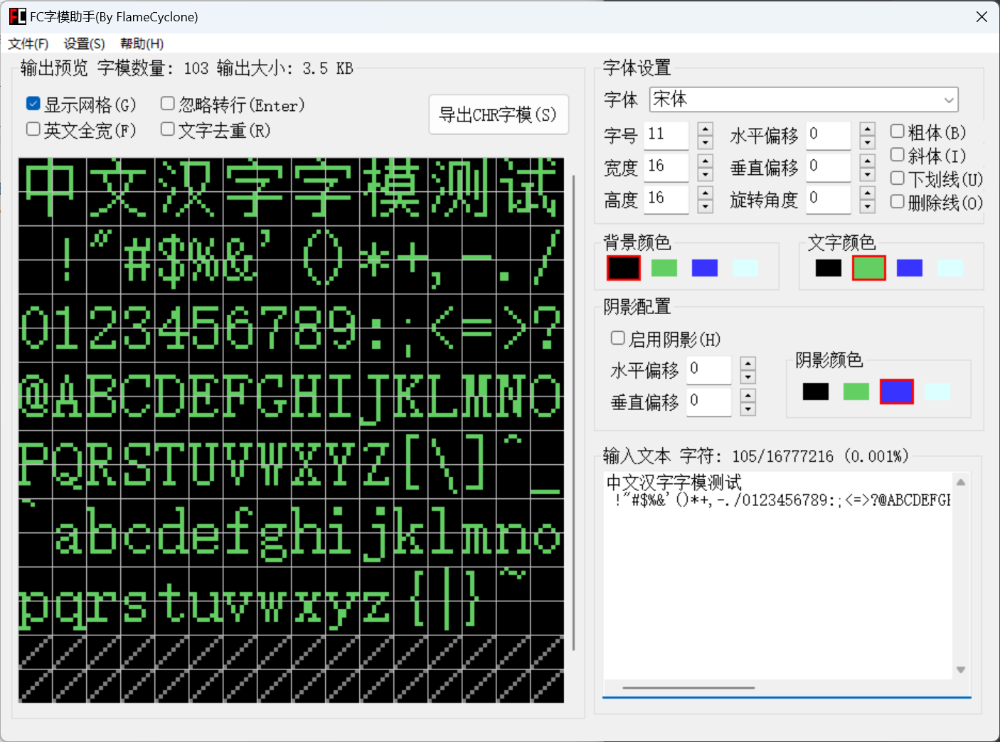

# FC字模助手

最近捣鼓大字体中文合卡菜单, 现有的字模工具不满足我的需求, 于是自己写了个字模工具, 支持常见操作

1.退出后打开能恢复上次退出时的所有状态

2.支持命令行调用, 如 FC_Font_Tool.exe -in list_output.txt -out chr_normal.chr -ini FC_Font_Tool.ini

3.实用的预览功能, 支持显示最终输出信息

